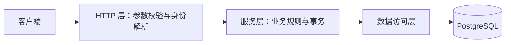
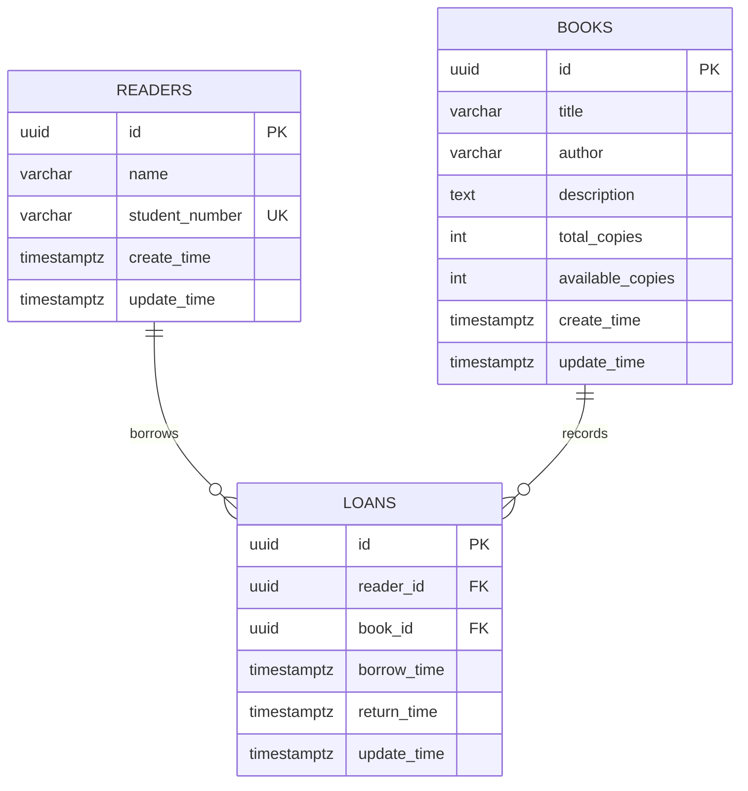
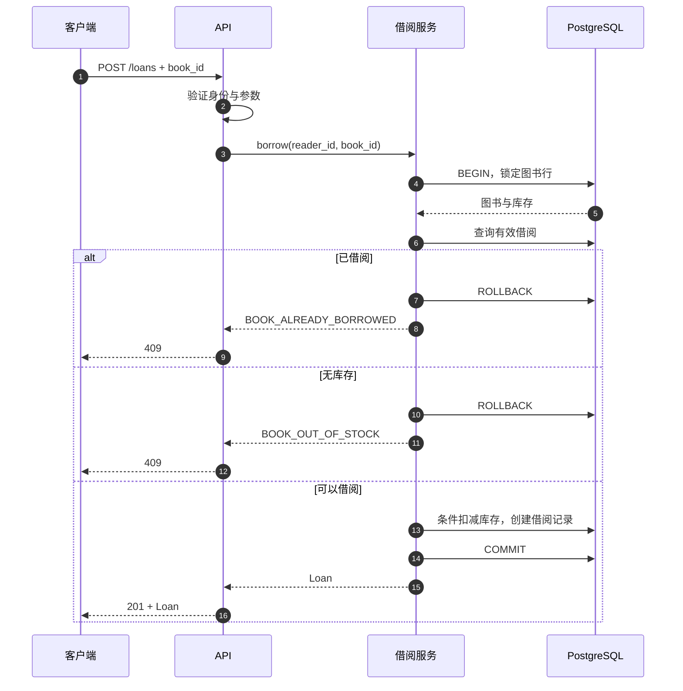
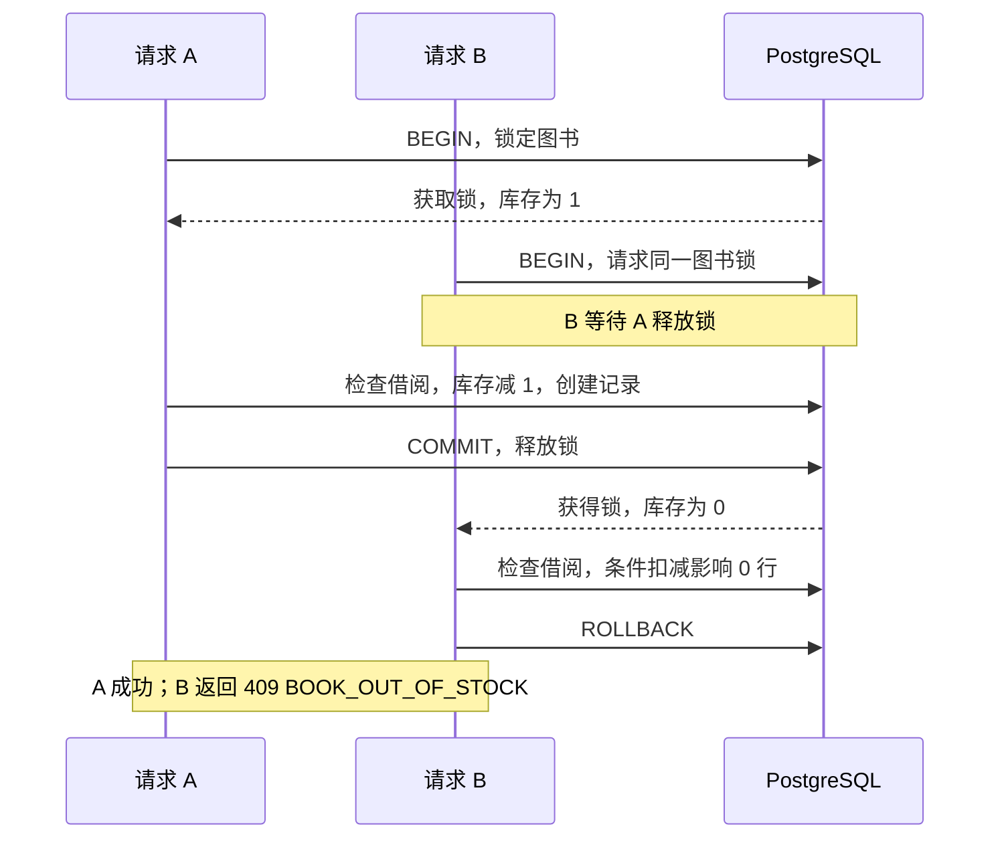
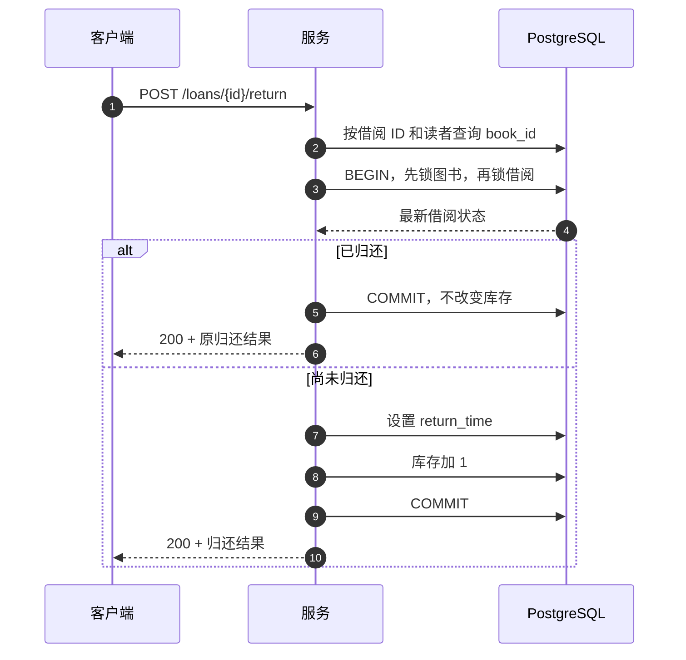

# 电子图书馆服务（Java）

Java 21 / Spring Boot 3.5.5 / Spring JDBC / PostgreSQL 17 / Flyway。

## 运行

需要 JDK 21、Maven 3.9+、Docker Compose（或现有 PostgreSQL）。在本目录执行：

```bash
docker compose up -d --wait
export DB_URL=jdbc:postgresql://localhost:5432/library
export DB_USER=library
export DB_PASSWORD=library
mvn spring-boot:run
```

服务监听 `http://localhost:8080`，Flyway 启动时自动执行版本化迁移。另开终端执行以下命令导入演示数据（可重复执行，不覆盖库存）：

```bash
docker compose exec -T db psql -U library -d library < seed.sql
```

本地数据库凭据仅用于演示。使用现有数据库时，通过 DB_URL、DB_USER、DB_PASSWORD 配置连接，使用 psql 执行 seed.sql。

## 请求示例

```bash
curl http://localhost:8080/api/v1/books
curl -X POST http://localhost:8080/api/v1/loans \
  -H 'Content-Type: application/json' \
  -H 'X-Reader-Id: 22222222-2222-4222-8222-222222222222' \
  -d '{"book_id":"11111111-1111-4111-8111-111111111111"}'
```

归还：`POST /api/v1/loans/{loan_id}/return`，携带同一身份头，无请求体。当前借阅：`GET /api/v1/me/loans`，携带身份头。

## 构建与测试

```bash
mvn clean verify
java -jar target/e-library-1.0.0.jar
```

普通测试包含接口 JSON 命名、参数验证、错误格式、事务回滚及加锁顺序检查。真实数据库测试采用专用 PostgreSQL，使用独立事务、20 个并发线程和同步起跑屏障；缺失 TEST_DB_URL 时明确跳过，不能据此认定并发测试已通过。

```bash
docker compose exec db createdb -U library library_test
export TEST_DB_URL=jdbc:postgresql://localhost:5432/library_test
export TEST_DB_USER=library
export TEST_DB_PASSWORD=library
mvn test
```

数据库测试会自动迁移，以随机 UUID 建立数据并清理。请仅指定专用测试库。并发测试验证最后一本争抢、同一读者重复借阅、重复归还，以及记录写入失败和归还失败的真实事务回滚。

## 本次验证结果

Java 21 下编译、JAR 打包成功，15 项单元及 HTTP 接口测试通过。8 项真实 PostgreSQL 集成测试因未配置 TEST_DB_URL 跳过，尚未验证真实数据库并发结果。当前环境 Docker 未运行，临时 PostgreSQL 受沙箱共享内存限制无法启动；配置独立数据库后按上方命令运行全部测试。

## 代码结构与实现说明

```text
src/main/java/com/example/library/
├── LibraryApplication.java
├── controller/LibraryController.java
├── model/Models.java
├── service/LibraryService.java
├── repository/LibraryRepository.java
├── exception/
│   ├── BusinessException.java
│   └── ApiExceptionHandler.java
└── filter/RequestIdFilter.java
```

- `controller`：HTTP 接口、入参校验与接口注释。
- `model`：请求、响应及分页数据定义。
- `service`：业务规则、事务与重试。
- `repository`：参数化 SQL 与数据库访问。
- `exception`：业务异常与统一异常响应。
- `filter`：请求 ID 生成与追踪。
- `src/main/resources/db/migration/`：Flyway 数据库迁移。
- `src/test/java/com/example/library/`：分别在 controller、service、integration 包中组织接口、业务及数据库测试。

事务通过 TransactionTemplate 显式执行，避免同类调用导致声明式事务失效。隔离级别 READ COMMITTED，统一先锁图书再锁借阅。数据库时钟生成借还时间，确保 Loan 的 borrow_time / return_time 与对应 update_time 完全一致。未实现图书/读者修改接口，未来新增信息更新时必须同步设置 update_time。

图书列表直接复用 Book DTO，因此比下方最小 API 示例多返回 description 和 create_time。当前版本以 Controller 的 JavaDoc、Models 及本 README 提供接口定义，没有启用 Swagger 页面。身份头只模拟身份，不代表生产认证。数据库连接不可用返回 503，提交结果未知时不自动重试。

---

## 完整技术设计方案

# 电子图书馆服务技术设计

版本：1.0  
状态：待实现  
数据库：PostgreSQL  
接口风格：REST / JSON

## 1. 目标与范围

实现浏览图书、查询详情、借阅、归还和查看当前借阅。核心保证：库存不超借，同一读者不能同时重复借阅同一本书，重复归还不能重复释放库存。

原始文档未指定数据库、身份认证和具体接口格式，本文将这些内容作为实现假设。电子书库存代表并发借阅许可；每个图书版本对应一个独立 book_id；归还后允许再次借阅。

本次不实现注册登录、预约、到期自动归还、罚款、电子书内容交付及已有库存调整接口。支持图书和学生录入，也可使用种子数据初始化。

## 2. 业务规则

1. 可借库存始终满足 0 ≤ available_copies ≤ total_copies。
2. 同一 reader_id 和 book_id 最多存在一条 return_time 为空的借阅记录。
3. 借阅记录创建和库存扣减必须在同一事务中提交。
4. 归还状态更新和库存增加必须在同一事务中提交。
5. 归还接口具有业务幂等性：重复归还返回成功，不重复增加库存。
6. 借阅接口不提供请求键幂等机制；成功后重试会返回重复借阅冲突，客户端可查询当前借阅确认结果。
7. 读者只能查询和归还自己的借阅。访问其他读者的借阅返回 404。
8. 时间使用 UTC 存储，API 使用 RFC 3339 格式；ID 使用 UUID。

## 3. 应用架构



HTTP 层负责协议转换和错误映射；服务层负责借阅与归还流程、事务边界；数据访问层执行 SQL。事务使用同一数据库连接。采用单体服务，不引入缓存、消息队列或分布式锁。

## 4. 数据结构

### 4.1 Book

| 字段 | 类型 | 必填 | 说明 |
|---|---|---|---|
| id | UUID | 是 | 图书标识 |
| title | varchar(255) | 是 | 书名 |
| author | varchar(255) | 是 | 作者或作者展示文本 |
| description | text | 否 | 简介 |
| total_copies | integer | 是 | 总许可数，非负 |
| available_copies | integer | 是 | 当前可借许可数 |
| create_time | timestamptz | 是 | 创建时间 |
| update_time | timestamptz | 是 | 最近更新时间 |

### 4.2 Reader

学生以 student_number（学号）作为业务唯一标识；id 作为内部主键和借阅外键。

| 字段 | 类型 | 必填 | 说明 |
|---|---|---|---|
| id | UUID | 是 | 读者标识 |
| name | varchar(100) | 是 | 展示名称 |
| student_number | varchar(64) | 是 | 学号，唯一，保留前导零 |
| create_time | timestamptz | 是 | 创建时间 |
| update_time | timestamptz | 是 | 最近更新时间 |

### 4.3 Loan

| 字段 | 类型 | 必填 | 说明 |
|---|---|---|---|
| id | UUID | 是 | 单次借阅标识 |
| reader_id | UUID | 是 | 读者外键 |
| book_id | UUID | 是 | 图书外键 |
| borrow_time | timestamptz | 是 | 借阅时间 |
| return_time | timestamptz | 否 | 归还时间；空表示有效借阅 |
| update_time | timestamptz | 是 | 最近更新时间 |

不存储独立 status 字段，避免状态与 return_time 不一致。API 根据 return_time 派生 BORROWED 或 RETURNED。



### 4.4 PostgreSQL DDL

UUID 由应用生成。业务数据不提供删除接口，外键默认阻止删除已有借阅关联的图书和读者。

```sql
CREATE TABLE readers (
    id UUID PRIMARY KEY,
    name VARCHAR(100) NOT NULL,
    student_number VARCHAR(64) NOT NULL,
    CONSTRAINT uq_reader_student_number UNIQUE (student_number),
    CONSTRAINT ck_reader_student_number CHECK (student_number = btrim(student_number) AND length(btrim(student_number)) > 0),
    create_time TIMESTAMPTZ NOT NULL DEFAULT CURRENT_TIMESTAMP,
    update_time TIMESTAMPTZ NOT NULL DEFAULT CURRENT_TIMESTAMP
);

CREATE TABLE books (
    id UUID PRIMARY KEY,
    title VARCHAR(255) NOT NULL,
    author VARCHAR(255) NOT NULL,
    description TEXT,
    total_copies INTEGER NOT NULL CHECK (total_copies >= 0),
    available_copies INTEGER NOT NULL,
    create_time TIMESTAMPTZ NOT NULL DEFAULT CURRENT_TIMESTAMP,
    update_time TIMESTAMPTZ NOT NULL DEFAULT CURRENT_TIMESTAMP,
    CONSTRAINT ck_book_stock CHECK (
        available_copies >= 0 AND available_copies <= total_copies
    )
);

CREATE TABLE loans (
    id UUID PRIMARY KEY,
    reader_id UUID NOT NULL REFERENCES readers(id),
    book_id UUID NOT NULL REFERENCES books(id),
    borrow_time TIMESTAMPTZ NOT NULL DEFAULT CURRENT_TIMESTAMP,
    return_time TIMESTAMPTZ,
    update_time TIMESTAMPTZ NOT NULL DEFAULT CURRENT_TIMESTAMP,
    CONSTRAINT ck_loan_time CHECK (
        return_time IS NULL OR return_time >= borrow_time
    )
);

CREATE UNIQUE INDEX uq_active_loan
    ON loans (reader_id, book_id) WHERE return_time IS NULL;

CREATE INDEX idx_reader_active_loans
    ON loans (reader_id, borrow_time DESC, id DESC)
    WHERE return_time IS NULL;

CREATE INDEX idx_books_listing ON books (create_time DESC, id DESC);
```

数据库 CHECK 保护单行库存范围，部分唯一索引保护重复借阅。跨表关系“可借库存 = 总库存 − 有效借阅数”依赖所有库存写入遵循本文事务协议，普通 CHECK 无法直接保证该关系。种子数据初始无借阅，available_copies 等于 total_copies。

### 4.5 更新时间规则

Book、Reader、Loan 均包含 update_time。创建时设置为创建时刻；持久化信息实际发生修改时更新为当前 UTC 时间。Book 的元数据修改、借阅扣减库存及归还增加库存均更新 update_time；Reader 信息修改时更新 update_time；Loan 创建时 update_time 等于 borrow_time，首次归还时 update_time 等于 return_time。重复归还及没有实际变化的请求不刷新 update_time。

更新时间由服务端在写入语句中设置，并与业务更新在同一事务内提交，不能接受客户端传入。DEFAULT 仅负责插入默认值，不会自动处理 UPDATE。

## 5. 通用 API 约定

- 基础路径：`/api/v1`。
- 请求和响应使用 `application/json`；GET 无请求体。
- 演示身份：借阅、归还、当前借阅接口必须提供 `X-Reader-Id: <UUID>`。这是可信演示环境的身份模拟，正式部署必须替换为认证中间件解析出的身份，不能信任客户端任意指定读者。
- 读者头缺失或无效，或读者不存在，统一返回 401；普通路径或 JSON 中的 UUID 不合法返回 400。
- 分页：page 默认 1、最小 1；page_size 默认 20、范围 1–100；越界返回 400。
- 列表稳定排序：create_time DESC, id DESC；当前借阅按 borrow_time DESC, id DESC。分页期间数据变化可能导致跨页移动，本次不承诺快照分页。
- 列表响应为 items、page、page_size，不返回总数，空页返回空数组。
- 所有响应携带 `X-Request-Id`，错误体同时返回 request_id。

## 6. API 定义

### 6.1 浏览图书

`GET /api/v1/books?page=1&page_size=20`

无需身份。入参为上述两个可选分页查询参数。成功返回 200：

```json
{
  "items": [
    {
      "id": "11111111-1111-4111-8111-111111111111",
      "title": "数据库系统概念",
      "author": "Abraham Silberschatz 等",
      "total_copies": 3,
      "available_copies": 2,
      "update_time": "2026-11-09T03:00:00Z"
    }
  ],
  "page": 1,
  "page_size": 20
}
```

items 中的每项为 BookSummary，包含 update_time（RFC 3339 时间字符串）。库存是查询时的快照，不构成借阅成功承诺。

### 6.2 查询图书详情

`GET /api/v1/books/{book_id}`

路径参数 book_id 为必填 UUID。无需身份。成功返回 200，字段为 BookSummary 加 description（string 或 null）和 create_time：

```json
{
  "id": "11111111-1111-4111-8111-111111111111",
  "title": "数据库系统概念",
  "author": "Abraham Silberschatz 等",
  "description": "数据库原理与实践。",
  "total_copies": 3,
  "available_copies": 2,
  "create_time": "2026-11-09T02:00:00Z",
  "update_time": "2026-11-09T03:00:00Z"
}
```

不存在返回 404 BOOK_NOT_FOUND。

### 6.3 借阅图书

`POST /api/v1/loans`

必须提供身份头。请求体：

```json
{
  "book_id": "11111111-1111-4111-8111-111111111111"
}
```

book_id 为必填 UUID；不接受 reader_id、借阅时间、状态等由服务端决定的字段，未知字段返回 400。

成功返回 201：

```json
{
  "id": "33333333-3333-4333-8333-333333333333",
  "book_id": "11111111-1111-4111-8111-111111111111",
  "reader_id": "22222222-2222-4222-8222-222222222222",
  "status": "BORROWED",
  "borrow_time": "2026-11-09T03:00:00Z",
  "return_time": null,
  "update_time": "2026-11-09T03:00:00Z"
}
```

返回对象为 Loan，update_time 为 RFC 3339 时间字符串。book_id、reader_id、id 为 UUID 字符串，status 为枚举，borrow_time 为时间字符串，return_time 为时间字符串或 null。

业务错误：404 BOOK_NOT_FOUND；409 BOOK_ALREADY_BORROWED；409 BOOK_OUT_OF_STOCK。重复借阅检查优先于库存检查，因此已借阅者在库存为零时仍得到 BOOK_ALREADY_BORROWED。

### 6.4 归还图书

`POST /api/v1/loans/{loan_id}/return`

必须提供身份头。loan_id 为必填 UUID，无请求体。成功返回 200 和 Loan 对象：

```json
{
  "id": "33333333-3333-4333-8333-333333333333",
  "book_id": "11111111-1111-4111-8111-111111111111",
  "reader_id": "22222222-2222-4222-8222-222222222222",
  "status": "RETURNED",
  "borrow_time": "2026-11-09T03:00:00Z",
  "return_time": "2026-11-09T04:00:00Z",
  "update_time": "2026-11-09T04:00:00Z"
}
```

重复请求返回同一归还结果，保留第一次 return_time。不存在或不属于当前读者时返回 404 LOAN_NOT_FOUND。

### 6.5 查看当前借阅

`GET /api/v1/me/loans?page=1&page_size=20`

必须提供身份头。分页参数同浏览接口。仅返回当前读者 return_time 为空的借阅，成功返回 200：

```json
{
  "items": [
    {
      "id": "33333333-3333-4333-8333-333333333333",
      "book_id": "11111111-1111-4111-8111-111111111111",
      "reader_id": "22222222-2222-4222-8222-222222222222",
      "status": "BORROWED",
      "borrow_time": "2026-11-09T03:00:00Z",
      "return_time": null,
  "update_time": "2026-11-09T03:00:00Z",
      "book": {
        "id": "11111111-1111-4111-8111-111111111111",
        "title": "数据库系统概念",
        "author": "Abraham Silberschatz 等"
      }
    }
  ],
  "page": 1,
  "page_size": 20
}
```

items 的字段为 Loan 加 book（id、title、author），通过关联查询一次加载，避免逐条查询图书。

## 7. 错误处理

统一错误体：

```json
{
  "error": {
    "code": "BOOK_ALREADY_BORROWED",
    "message": "你已借阅这本书，请先归还",
    "request_id": "req-example"
  }
}
```

| HTTP | code | 场景 |
|---|---|---|
| 400 | INVALID_ARGUMENT | JSON 错误、参数缺失、字段类型错误、未知请求字段、分页越界 |
| 401 | UNAUTHENTICATED | 身份头缺失、无效或读者不存在 |
| 404 | BOOK_NOT_FOUND | 图书不存在 |
| 404 | LOAN_NOT_FOUND | 借阅不存在或属于其他读者 |
| 409 | STUDENT_NUMBER_ALREADY_EXISTS | 学号已录入 |
| 409 | BOOK_ALREADY_BORROWED | 已存在有效借阅 |
| 409 | BOOK_OUT_OF_STOCK | 可借库存不足 |
| 503 | SERVICE_BUSY | 锁等待超时或可重试事务冲突重试耗尽 |
| 500 | INTERNAL_ERROR | 非预期错误或数据不变量被破坏 |

只将命中 uq_active_loan 的唯一冲突映射为重复借阅；其他约束错误不能统一映射成 409。数据库异常后先回滚，再转换错误。响应不暴露 SQL、堆栈或连接信息。

## 8. 事务与并发控制

隔离级别使用 READ COMMITTED。图书行锁是同一本书所有借阅、归还操作的串行化入口，适用于多个服务实例。无需进程内锁或 Redis 锁。

统一锁顺序：先锁 books，再锁或写 loans。每次事务只处理一本书。借阅归还之外的未来写入操作也必须遵守该约定。

### 8.1 借阅事务

```sql
BEGIN;
SET LOCAL lock_timeout = '2s';

SELECT id, available_copies FROM books WHERE id = :book_id FOR UPDATE;
-- 不存在：回滚并返回 BOOK_NOT_FOUND。

SELECT id FROM loans
WHERE reader_id = :reader_id AND book_id = :book_id
  AND return_time IS NULL;
-- 已存在：回滚并返回 BOOK_ALREADY_BORROWED。

UPDATE books SET available_copies = available_copies - 1, update_time = clock_timestamp()
WHERE id = :book_id AND available_copies > 0;
-- 影响行数必须为 1，否则回滚并返回 BOOK_OUT_OF_STOCK。

-- :borrow_time 为服务端获取锁后生成的一次时间值。
INSERT INTO loans (id, reader_id, book_id, borrow_time, update_time)
VALUES (:loan_id, :reader_id, :book_id, :borrow_time, :borrow_time)
RETURNING *;

COMMIT;
```

同一图书的并发请求在行锁上排队。后续请求拿到锁后执行新的检查语句，在 READ COMMITTED 下能够看到前一事务已提交的借阅。部分唯一索引提供额外保护；插入失败时库存扣减一并回滚。

### 8.2 归还事务

首先按 loan_id 和当前 reader_id 只读查询 book_id；不存在则返回 404。book_id、reader_id 在创建后不可更改，借阅记录不可删除，因此该查询可以作为锁定图书的定位步骤，但不能据此直接判断最终归还状态。

```sql
BEGIN;
SET LOCAL lock_timeout = '2s';

SELECT id FROM books WHERE id = :book_id FOR UPDATE;

SELECT * FROM loans
WHERE id = :loan_id AND reader_id = :reader_id FOR UPDATE;
-- 不存在：回滚并返回 LOAN_NOT_FOUND。
-- return_time 非空：提交只读结果，返回已有 Loan，不增加库存。

-- :return_time 为服务端生成的一次时间值。
UPDATE loans SET return_time = :return_time, update_time = :return_time
WHERE id = :loan_id AND return_time IS NULL
RETURNING *;
-- 影响行数必须为 1。

UPDATE books SET available_copies = available_copies + 1, update_time = clock_timestamp()
WHERE id = :book_id AND available_copies < total_copies;
-- 影响行数必须为 1；否则视为数据异常，回滚并告警。

COMMIT;
```

时间在获取锁后生成，避免等待事务锁时使用过早的事务开始时间。只有提交成功后才向客户端发送成功响应。

### 8.3 超时与重试

锁等待上限建议 2 秒，允许通过配置调整。死锁或序列化失败在确认事务已回滚后，最多重试整个事务 2 次，使用短随机退避；耗尽返回 503。锁等待超时直接返回 503，避免持续增加热点压力。

提交阶段连接断开可能导致结果未知，不能假定事务已回滚并盲目重试借阅。返回失败后客户端查询当前借阅确认；重复借阅仍由唯一约束阻止。若未来要求跨归还周期的请求去重，需要额外的 Idempotency-Key 持久化设计。

## 9. 时序图

### 9.1 借阅



### 9.2 两位读者争抢最后一本



如果 A、B 属于同一读者，B 获取锁后会先发现已有有效借阅，返回 BOOK_ALREADY_BORROWED。

### 9.3 归还与重复归还



## 10. 验证与验收标准

并发测试使用真实 PostgreSQL、独立连接和同步起跑屏障，不使用单连接串行调用或数据库 Mock 代替。

| 测试场景 | 验收结果 |
|---|---|
| 正常借阅和归还 | 创建记录、状态和库存变化正确 |
| 无库存借阅 | 409，库存和记录不变 |
| 同一读者重复借阅 | 409，只有一条有效记录 |
| 归还后再次借阅 | 成功创建新的记录，历史记录保留 |
| 重复归还 | 200，归还时间保持不变，库存仅增加一次 |
| 访问他人借阅 | 404，数据无变化 |
| 库存 1，20 位读者并发借阅 | 测试超时内完成时恰好 1 次成功，其余库存冲突；库存 0 |
| 库存 20，同一读者 20 次并发借阅 | 恰好 1 次成功，其余重复借阅；库存 19 |
| 同一借阅 20 次并发归还 | 全部成功，库存只加 1 |
| 归还与其他读者借阅并发 | 结果符合某个串行顺序，无负库存；先到的借阅可能因库存不足失败 |
| 在库存扣减后模拟记录写入失败 | 借阅与库存全部回滚 |
| 在归还更新后模拟库存更新失败 | 归还状态回滚，库存保持原值 |
| 锁等待超时 | 返回 503，事务回滚，无部分写入 |

每个并发测试结束后验证：库存范围合法；不存在重复有效借阅；available_copies = total_copies − 有效借阅数量。功能测试另覆盖参数验证、身份错误、分页和空列表。

## 11. 交付与设计取舍

交付源码、数据库迁移、种子数据、自动化测试和 README。README 应提供环境要求、启动命令、迁移与种子命令、测试命令、请求示例、身份模拟说明和本文并发策略。

保留 available_copies 使库存读取和条件扣减简单，代价是必须维护跨表一致性；图书行锁便于审查和验证，代价是热门图书写请求串行执行。对于本次作业规模，这是清晰且可维护的选择。后续若引入库存管理、自动归还或批量借阅，需要重新审查所有写入路径和锁顺序。


## 新增：图书与学生录入接口

学生沿用 Reader 实体与 readers 表，姓名和学号均必填，以学号唯一识别学生，允许同名。两接口用于演示，无需身份头；生产环境的图书和学生管理需要管理员授权。图书每次 POST 创建独立 UUID，不按书名去重；学生按学号去重，不提供请求键幂等。

### POST /api/v1/books/insert

录入图书，成功返回 201，响应为完整 Book（id、title、author、description、total_copies、available_copies、create_time、update_time）。

| 入参 | 类型 | 规则 |
|---|---|---|
| title | string | 必填，非空白，最多 255 字 |
| author | string | 必填，非空白，最多 255 字 |
| description | string/null | 可选 |
| total_copies | integer | 必填，非负；0 表示暂不可借 |

```json
{"title":"Java 入门","author":"示例作者","description":"Java 基础","total_copies":3}
```

服务端生成 id 和时间，available_copies 初始化为 total_copies。title、author 去除首尾空白；客户端不可提交 id、available_copies 或时间字段。create_time 与 update_time 在创建时相等。

### POST /api/v1/students/insert

录入学生，name 为必填非空白字符串，最多 100 字；student_number 为必填非空白字符串，最多 64 字。两者保存时去除首尾空白；学号大小写敏感，以字符串保存并保留前导零。数据库唯一约束防止重复学号，重复时返回 409 STUDENT_NUMBER_ALREADY_EXISTS。成功返回 201：

```json
{
  "id":"22222222-2222-4222-8222-222222222222",
  "name":"张三",
  "student_number":"20260001",
  "create_time":"2026-11-09T03:00:00Z",
  "update_time":"2026-11-09T03:00:00Z"
}
```

请求示例：`{"name":"张三","student_number":"20260001"}`。返回 id 可作为后续借阅请求的 X-Reader-Id。所有必填、长度、库存及未知字段验证失败统一返回 400 INVALID_ARGUMENT。

### 手动测试闭环

```bash
# 1. 创建学生，复制响应 id 作为后续 X-Reader-Id
curl -X POST http://localhost:8080/api/v1/students/insert \
  -H 'Content-Type: application/json' -d '{"name":"张三","student_number":"20260001"}'

# 2. 创建图书，复制响应 id 作为借阅的 book_id
curl -X POST http://localhost:8080/api/v1/books/insert \
  -H 'Content-Type: application/json' \
  -d '{"title":"Java 入门","author":"示例作者","total_copies":2}'

# 3. 将占位符替换为上面真实返回的 UUID
curl -X POST http://localhost:8080/api/v1/loans \
  -H 'Content-Type: application/json' -H 'X-Reader-Id: <student_id>' \
  -d '{"book_id":"<book_id>"}'

# 4. 再次借阅应返回 409；归还后可再次借阅
curl -X POST http://localhost:8080/api/v1/loans/<loan_id>/return \
  -H 'X-Reader-Id: <student_id>'
```

自动化测试覆盖录入成功、必填/空白/负库存/超长姓名/禁止客户端设置库存和 ID；真实数据库测试另验证录入→借阅→当前借阅→归还的闭环与初始库存、时间字段。

## 学号升级与兼容设计

新增 student_number：姓名可以重复，学号必须唯一。录入接口的 student_number 为必填字段，返回对象同样包含该字段。现有 X-Reader-Id 继续使用学生内部 UUID；学号用于业务识别和录入去重，不作为认证凭证。借阅记录的 reader_id 外键保持有效。

迁移采用 `V2__add_student_number.sql`，不修改已执行的 V1 校验和。新库依次执行 V1、V2；旧库先添加字段，再给旧学生分配 `LEGACY-<原 UUID>` 唯一临时编号，更新 update_time，最后施加非空和唯一约束。临时编号不是真实学号，上线前应按实际学生名册核对并补录；修改学号时须同时更新 update_time。本文建表 SQL 展示最终结构，实际升级以 Flyway 迁移为准。

录入相同学号的并发请求由唯一约束保证最多一条成功；冲突请求回滚并返回 409。学号去除首尾空白后比较，大小写敏感，前导零保留。例如 `00123` 和 `123` 是不同学号。同名且不同学号可分别创建学生。

种子数据使用学号 20260001；已有旧种子 UUID 不会被 seed.sql 自动覆盖，需按上述迁移说明补录。
